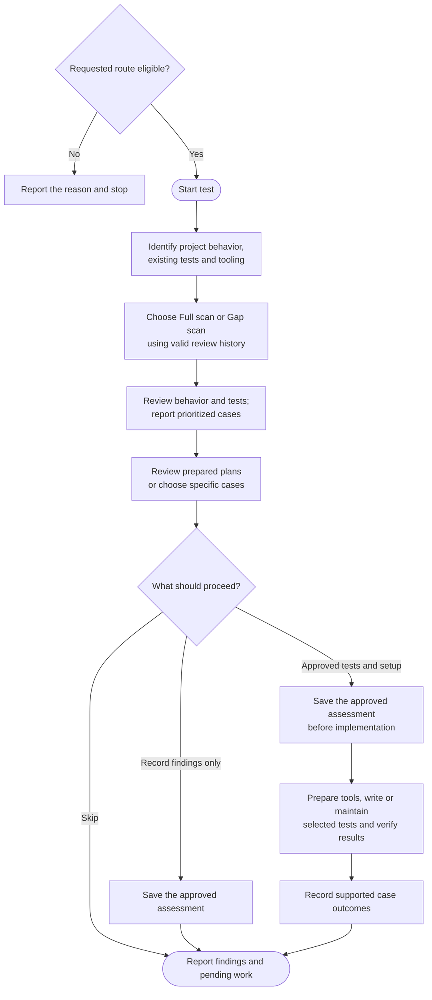

# Test



Test turns gaps in protection into cases you can review and choose. It can improve existing tests as well as add new ones, while keeping assessment, implementation and verified results distinct.

## Flow

## Start the command

Normal test checks for clean main/master, an established feature or maintenance branch, or a confirmed environment branch before source/test inventory. An explicitly requested read-only source assessment can inspect pending edits without project execution, ledger access or fixes. The workflow preserves unrelated work instead of stashing it to make room.

Existing assessment records are validated before the normal source inventory. Where needed, one helper read can validate a record and return a useful index together. An absent record needs no parser setup until an approved first write requires validation; the agent does not build a replacement validator during the review. Unsupported or malformed records end the run without a source-only fallback. A failed prerequisite stops the run, including further assessment or planning. A later setup, verification or checkpoint failure preserves completed assessments and actual drafts without continuing other work. An unanswered workflow question pauses the run; it does not authorize independent investigation while you decide.

## Choose the review scope

A Full scan assesses behavior and the protection provided by existing tests. A Gap scan starts from a valid earlier assessment, follows changed behavior and consumers, and revisits affected findings across open, resolved and obsolete states. Older open backlog remains visible, with unchanged records outside the review distinguished from current assessments. A first run or an unusable baseline may need Full scan.

The assessment asks what could go wrong and whether a test would detect it. Counts and coverage percentages alone cannot answer that. A passing test can still assert the wrong thing or never reach the important failure path.

Before presenting a need as new, test compares it with relevant recorded guarantees, evidence and protecting tests. A changed title, moved file or different explanation does not by itself make a different finding. Several tests may address one guarantee; a genuine split into separate needs is explained with its old-to-new mapping. Matching records keep their identity rather than returning as new issues under new wording.

## What kinds of tests can it suggest?

Suggestions follow the actual stack and risk: unit cases, integration checks, accessibility behavior, fixtures, runner repairs or a different testing technique when it serves the project.

Existing tests can be clarified or consolidated. Removing one needs evidence that its behavior is obsolete or remains protected elsewhere. A failing assertion is not permission to weaken the guarantee.

For example, a payment retry case should verify the externally important outcome, such as avoiding a duplicate charge. Repeating each internal helper call in an assertion can make the test brittle without protecting that outcome.

## Priorities and your selection

Each finding explains the missing protection, evidence, priority and readiness. Priority describes risk; implementation cost is separate. Unclear intended behavior is surfaced before a case is written, rather than turned into an invented expectation.

Choose recommended work, all ready cases, a subset or none. A fully prepared recommended plan or plan for all ready cases can be selected and approved in one decision, with exact cases, paths, tools, execution effects and record changes visible first. There is no repeated Apply question for that unchanged plan.

Custom selections need their resulting plan reviewed, including replacement guarantees and prerequisites. Unresolved intent or intrusive execution stays pending until its own required decision is made. Findings are saved before implementation under the approved checkpoint plan; selecting none does not authorize a new record write or mark findings fixed. Unknown implementation diffs and later commits are not pre-approved.

## Tools and verification

Existing tools come first. Runner setup, installations, upgrades and database or service effects need to be part of the approved plan. An apparently local test command can still run hooks, contact a service or reset data, so the actual entrypoint and target matter.

Work proceeds in coherent groups of cases. Failed, unavailable or deferred required checks keep those cases unverified. Approved additive drafts may remain uncommitted when the required verification cannot run. Coverage claims need measurements, and a failed case can reveal production work outside the testing task.

## Your result and the next run

The report separates the assessment, test changes, measured results and remaining work. Saved findings preserve decisions and useful closed history; deferred, skipped and accepted-risk cases do not count as verified protection.

Status records what was established in its context. An open case is reassessed when relevant: it may still need work, now have adequate protection, or no longer apply. A resolved case is checked when related changes or a matching observation put its guarantee in question; proven loss of protection reopens that same case. An obsolete case can return when its original requirement returns. A file edit or unavailable runner alone cannot determine any of these outcomes, and an old passing result never becomes a current pass automatically. Earlier deferral decisions are reused only while their context still holds.

Records keep concise guarantees, evidence references, actual decisions and supported closures. The helper returns bounded index pages and relevant full records across all states, avoiding a full ledger dump into each review. Path and wording changes can require different focused lookups; an empty narrow search is not proof that the issue is new. Unrelated closed history is not reassessed on every Gap scan. Paging reduces review context, while complete structural validation still has a cost and preserves its resource limits.

The ledger holds current judgments; Git retains prior versions. It does not accumulate full logs, repeated run summaries or every existing test. Useful closed records and unknown fields remain preserved, and size alone never authorizes deleting them or rewriting their evidence. Later runs can continue from this history without pretending the whole project was reassessed.

Changes finish locally on the same branch. [Refactor](../refactor.html#refactor-vs-test) owns behavior-preserving source improvements; neither workflow invokes the other automatically.

## Explore the source

For implementation details, read [guides/test.md](https://github.com/myowinthein/agent-helm/blob/main/guides/test.md).
