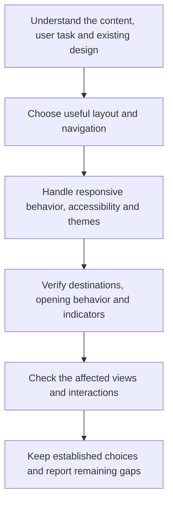

# Design



Design guides interfaces around real content and user tasks. It combines responsive and accessible behavior with deliberate visual choices, while preserving the project's established identity and interaction patterns.

## Flow

## What it asks the agent to do

Choose the structure that helps the person use the product. A familiar component can be appropriate, but it should earn its place. Repeating a centered hero, card grid, nested surfaces and decorative badges by habit can obscure what makes the content useful.

The same applies to typography, color and motion. Automatically switching to cream-and-serif or dark-and-neon creates another default rather than a considered design. Invented testimonials, dashboard numbers and decorative charts should not stand in for actual product information.

For example, a short reference page may need a clear reading column and section links. Turning every paragraph into a card can add borders and spacing without making the explanation easier to absorb.

## Responsive interfaces and links

Layouts should preserve access to content and actions as the viewport narrows, text grows or navigation changes. Consider keyboard operation, focus, reading order, contrast and reduced motion as part of normal interface work. WCAG 2.2 Level AA is the default accessibility reference, including its stated exceptions.

### Theme preferences

Automatic behavior can work behind a simple Light/Dark toggle. Keep the project's existing control and settings mechanism; a System option is useful when already supported, but the rule does not require adding one.

The important distinction is between the visitor's choice and the appearance currently shown:

| Situation | Expected behavior |
|---|---|
| No valid saved choice | Follow the browser-reported system preference, subject to an explicit project default. Use the project default or light if the browser cannot report a preference. |
| Visitor chooses Light or Dark | Apply and remember that choice, even when it matches the current system theme. |
| System theme changes | Update only while following the system; preserve manual overrides. |
| Another tab changes this project's preference | Reflect the new choice in its other open tabs and windows. |
| System is selected, when available, or the override is cleared | Resume automatic behavior. |
| Storage is blocked | Keep switching available for the current page; a later visit may return to the default. |

For example, an initial dark system theme should not create a saved Dark override. If the visitor then chooses Light, the site stays light through later system changes until that override is changed or cleared.

The default scope is one project within one browser profile, including later visits. Different browsers, profiles and devices remain independent unless the project already provides account synchronization or explicitly requires another scope. Since browser storage is [shared by origin](https://developer.mozilla.org/en-US/docs/Web/API/Window/localStorage), projects on the same host need separate preference keys to avoid changing each other's themes. Choices last until changed or browser data is removed; private browsing can shorten that lifetime.

Set the initial theme before the page appears so the wrong scheme does not flash first, and keep browser-drawn controls aligned with it. Verify the automatic and manual paths, updates in another tab and unavailable storage. These defaults guide theme work; they do not introduce a new control, account service or redesign into unrelated tasks.

### Links

Links navigate to destinations; buttons perform actions. A phrase about a particular procedure should reach the relevant section rather than making readers search from a homepage.

| Situation | Default treatment |
|---|---|
| Internal page or section | Current tab, without an external-link icon. |
| External text navigation | Current tab, with the northeast arrow leaving an open square. |
| Required new tab or window | No opening notice; external icon only for an external destination. |
| Download or email/phone/app action | Native handling and wording that explains the outcome. |

A shared organization or parent domain does not automatically make two services internal. Use the actual site boundary and configured aliases. Preserve native middle-click, modified-click and browser menu choices.

A new context can preserve an unfinished task or meet an explicit product requirement. Merely being external is insufficient. Do not add visible or hidden announcements for opening behavior: no label suffixes, tooltips, accessible-only text, live announcements, dialogs or shared group notices. Keep labels focused on the destination; the icon identifies an external destination independently of tab behavior. When Writing is also selected, use its [reference workflow](../writing.html#reference-links) to decide which phrases need links before applying these interface choices.

## Preserve project choices

Targeted work keeps the surrounding design system, branding, tokens, content and working accessibility. A new rule is not a mandate to redesign the whole application or replace an appropriate font, card or gradient.

Record project-specific decisions in existing local guidance or the design system. That separates stable product identity from the reusable rule, so reviewing a Helm update does not require recreating every customization.

## Basis and review

Accessibility standards inform the rule, while Helm's default external icon is local usability policy rather than a blanket WCAG AA requirement. Visual-pattern guidance is an editorial preference, not proof that a design was produced by AI.

A useful review points to concrete issues, explains their effect and proposes bounded improvements. Verify the affected viewport sizes, zoom, keyboard use, focus and links with available tools. A static screenshot cannot establish every interaction, and unavailable checks remain explicit.

Loading Design alone starts no redesign or scan. The requested task and the project's users determine what should change.

## Explore the source

For implementation details, read [rules/design.md](https://github.com/myowinthein/agent-helm/blob/main/rules/design.md).
