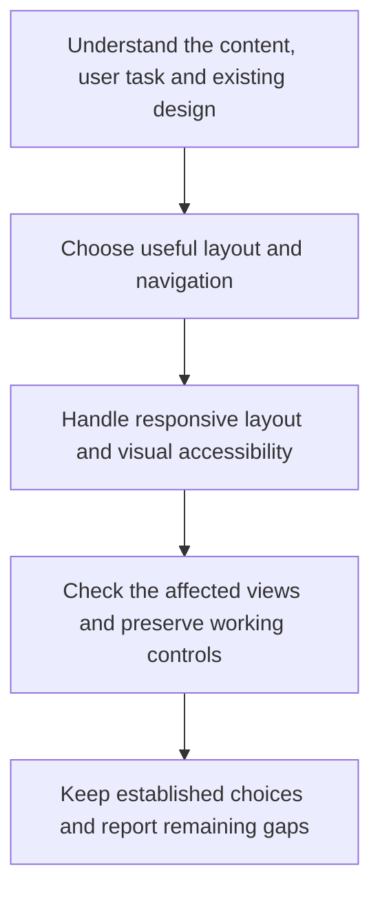

# Design



Design guides visual composition around real content and user tasks. It combines responsive layouts and accessibility with deliberate choices, preserving project identity and existing working interactions. Writing owns prose; the separately selected Interaction rule owns reusable control behavior and feedback.

## Flow

## What it asks the agent to do

Choose the structure that helps the person use the product. A familiar component can be appropriate, but it should earn its place. Repeating a centered hero, card grid, nested surfaces and decorative badges by habit can obscure what makes the content useful.

The same applies to typography, color and motion. Automatically switching to cream-and-serif or dark-and-neon creates another default rather than a considered design. Invented testimonials, dashboard numbers and decorative charts should not stand in for actual product information.

For example, a short reference page may need a clear reading column and section links. Turning every paragraph into a card can add borders and spacing without making the explanation easier to absorb.

Positive structure matters too. Use alignment and spacing to show which information belongs together, and use typography and hierarchy to communicate importance. The primary task and real content determine the composition. A repeated card or accent treatment only helps when it expresses a useful relationship; changing its color or border shape cannot give unrelated filler a purpose.

Comparable elements should reuse established patterns. Similar dialog errors can share placement and styling, while separators at the same level can use consistent spacing. A field error and a dialog-wide failure may need different treatment, just as a major section break may need more space than an internal divider. Preserve those intentional differences. Where no pattern exists, choose a coherent treatment for the requested surface; exact colors, icons and measurements belong to the project's components and design guidance.

## Responsive interfaces and links

Layouts should preserve access to content and actions as the viewport narrows, text grows or navigation changes. Consider keyboard operation, focus, reading order, contrast and reduced motion as part of normal interface work. WCAG 2.2 Level AA is the default accessibility reference, including its stated exceptions.

### Theme preferences

The extracted [Interaction guidance](../interaction/detailed.html#theme-preferences) explains automatic and saved choices, cross-tab updates and unavailable storage. Design retains readable colors and visual accessibility across supported themes.

### Input limits

[Interaction](../interaction/detailed.html#input-limits) now explains counters, pasted text, counting consistency and accessible validation feedback. Layout work preserves accepted data and existing controls.

### Cursors

[Interaction](../interaction/detailed.html#cursors) now covers pointer cues, unavailable states and recovery. Visual changes preserve working keyboard and touch operation.

### Links

[Interaction](../interaction/detailed.html#links) now owns opening behavior, destination indicators and native download/protocol handling. Meaningful editorial references remain with Writing.

### Link appearance

[Interaction](../interaction/detailed.html#link-appearance) now owns recognizable link states, underlines and focus feedback, using the project's palette and visual accessibility requirements. Its detailed policies require separate selection; Design alone preserves existing working interactions.

## Preserve project choices

Targeted work keeps the surrounding design system, branding, tokens, content and working accessibility. A new rule is not a mandate to redesign the whole application or replace an appropriate font, card or gradient.

Record project-specific decisions in existing local guidance or the design system. That separates stable product identity from the reusable rule, so reviewing a Helm update does not require recreating every customization.

## Basis and review

Accessibility standards inform the rule. Visual-pattern guidance is an editorial preference, not proof that a design was produced by AI. Interaction owns Helm's detailed control and link conventions.

A useful review points to concrete issues, explains their effect and proposes bounded improvements. Verify the affected viewport sizes, zoom, reading order and visual accessibility with available tools, preserving working keyboard and touch interaction. Interaction supplies its detailed control-state checks when separately selected. A static screenshot cannot establish every interaction, and unavailable checks remain explicit.

Loading Design alone starts no redesign or scan. The requested task and the project's users determine what should change.

## Explore the source

For implementation details, read [rules/design.md](https://github.com/myowinthein/agent-helm/blob/main/rules/design.md).
