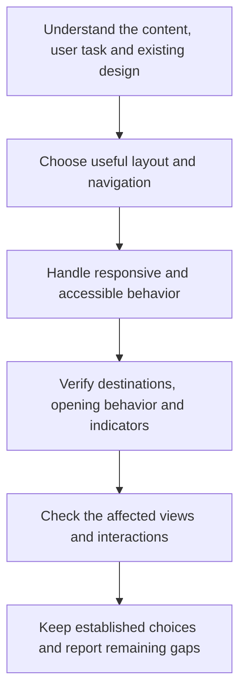

# Design



Design guides interfaces around real content and user tasks. It combines responsive and accessible behavior with deliberate visual choices, while preserving the project's established identity and interaction patterns.

## Flow

## What it asks the agent to do

Choose the structure that helps the person use the product. A familiar component can be appropriate, but it should earn its place. Repeating a centered hero, card grid, nested surfaces and decorative badges by habit can obscure what makes the content useful.

The same applies to typography, color and motion. Automatically switching to cream-and-serif or dark-and-neon creates another default rather than a considered design. Invented testimonials, dashboard numbers and decorative charts should not stand in for actual product information.

For example, a short reference page may need a clear reading column and section links. Turning every paragraph into a card can add borders and spacing without making the explanation easier to absorb.

## Responsive interfaces and links

Layouts should preserve access to content and actions as the viewport narrows, text grows or navigation changes. Consider keyboard operation, focus, reading order, contrast and reduced motion as part of normal interface work. WCAG 2.2 Level AA is the default accessibility reference, including its stated exceptions.

Links navigate to destinations; buttons perform actions. A phrase about a particular procedure should reach the relevant section rather than making readers search from a homepage.

| Situation | Default treatment |
|---|---|
| Internal page or section | Current tab, without an external-link icon. |
| External text navigation | Current tab, with the northeast arrow leaving an open square. |
| Required new tab or window | Visible and accessible opening warning; external icon only for an external destination. |
| Download or email/phone/app action | Native handling and wording that explains the outcome. |

A shared organization or parent domain does not automatically make two services internal. Use the actual site boundary and configured aliases. Preserve native middle-click, modified-click and browser menu choices.

A new context can preserve an unfinished task or meet an explicit product requirement. Merely being external is insufficient. The icon identifies where a link goes; the opening warning explains what the click does. When Writing is also selected, use its [reference workflow](../writing.html#reference-links) to decide which phrases need links before applying these interface choices.

## Preserve project choices

Targeted work keeps the surrounding design system, branding, tokens, content and working accessibility. A new rule is not a mandate to redesign the whole application or replace an appropriate font, card or gradient.

Record project-specific decisions in existing local guidance or the design system. That separates stable product identity from the reusable rule, so reviewing a Helm update does not require recreating every customization.

## Basis and review

Accessibility standards inform the rule, while Helm's default external icon and mandatory new-context wording are local usability policy. They are not blanket WCAG AA requirements. Visual-pattern guidance is an editorial preference, not proof that a design was produced by AI.

A useful review points to concrete issues, explains their effect and proposes bounded improvements. Verify the affected viewport sizes, zoom, keyboard use, focus and links with available tools. A static screenshot cannot establish every interaction, and unavailable checks remain explicit.

Loading Design alone starts no redesign or scan. The requested task and the project's users determine what should change.

## Explore the source

For implementation details, read [rules/design.md](https://github.com/myowinthein/agent-helm/blob/main/rules/design.md).
