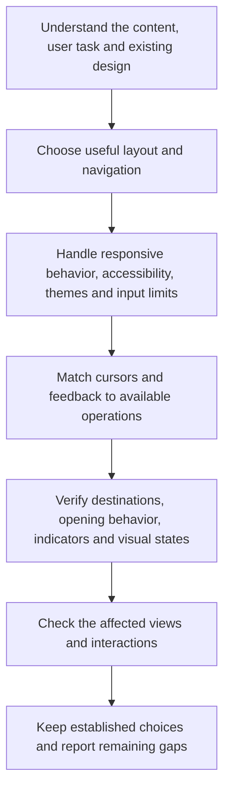

# Design



Design guides interfaces around real content and user tasks. It combines responsive and accessible behavior with deliberate visual choices, while preserving the project's established identity and interaction patterns.

## Flow

## What it asks the agent to do

Choose the structure that helps the person use the product. A familiar component can be appropriate, but it should earn its place. Repeating a centered hero, card grid, nested surfaces and decorative badges by habit can obscure what makes the content useful.

The same applies to typography, color and motion. Automatically switching to cream-and-serif or dark-and-neon creates another default rather than a considered design. Invented testimonials, dashboard numbers and decorative charts should not stand in for actual product information.

For example, a short reference page may need a clear reading column and section links. Turning every paragraph into a card can add borders and spacing without making the explanation easier to absorb.

## Responsive interfaces and links

Layouts should preserve access to content and actions as the viewport narrows, text grows or navigation changes. Consider keyboard operation, focus, reading order, contrast and reduced motion as part of normal interface work. WCAG 2.2 Level AA is the default accessibility reference, including its stated exceptions.

### Theme preferences

Automatic behavior can work behind a simple Light/Dark toggle. Keep the project's existing control and settings mechanism; a System option is useful when already supported, but the rule does not require adding one.

The important distinction is between the visitor's choice and the appearance currently shown:

| Situation | Expected behavior |
|---|---|
| No valid saved choice | Follow the browser-reported system preference, subject to an explicit project default. Use the project default or light if the browser cannot report a preference. |
| Visitor chooses Light or Dark | Apply and remember that choice, even when it matches the current system theme. |
| System theme changes | Update only while following the system; preserve manual overrides. |
| Another tab changes this project's preference | Reflect the new choice in its other open tabs and windows. |
| System is selected, when available, or the override is cleared | Resume automatic behavior. |
| Storage is blocked | Keep switching available for the current page; a later visit may return to the default. |

For example, an initial dark system theme should not create a saved Dark override. If the visitor then chooses Light, the site stays light through later system changes until that override is changed or cleared.

The default scope is one project within one browser profile, including later visits. Different browsers, profiles and devices remain independent unless the project already provides account synchronization or explicitly requires another scope. Since browser storage is [shared by origin](https://developer.mozilla.org/en-US/docs/Web/API/Window/localStorage), projects on the same host need separate preference keys to avoid changing each other's themes. Choices last until changed or browser data is removed; private browsing can shorten that lifetime.

Set the initial theme before the page appears so the wrong scheme does not flash first, and keep browser-drawn controls aligned with it. Verify the automatic and manual paths, updates in another tab and unavailable storage. These defaults guide theme work; they do not introduce a new control, account service or redesign into unrelated tasks.

### Input limits

Start with the reason for the limit. A fixed-format code and a short biography need different guidance, even though both accept text. A generous storage ceiling rarely needs a permanent counter. If normal answers repeatedly hit that ceiling, the constraint may need reviewing rather than more interface decoration.

| Field or task | Useful feedback |
|---|---|
| Ordinary name, email or address with a generous technical limit | No counter; explain unusual restrictions when they matter. |
| Six-digit verification code | A clear six-digit instruction; the format already communicates the length. |
| Title, short biography or other constrained writing | Maximum length and a live count that helps with composition. |
| Longer answer that rarely reaches its limit | Consider showing the count near the limit; choose the threshold for that task. |

These defaults draw on [GOV.UK](https://design-system.service.gov.uk/components/character-count/) and [USWDS](https://designsystem.digital.gov/components/character-count/). Neither calls for a counter simply because a field has a maximum. Input width can suggest the expected answer size, while borders or progress indicators can reinforce the limit. Important restrictions and detected errors still need understandable text; a red border or disappearing placeholder is insufficient.

**Keep the person's answer intact.** For composed text, it is usually more helpful to accept a full pasted draft, explain that it exceeds the writing limit and let the person shorten it before submission. For example, “12 characters over the limit” tells them how much editing is needed. Do not silently cut off the end of an answer or discard it after an error. Hard stops can suit specific field requirements, but need a deliberate choice and clear feedback. A larger resource-safety bound can still protect the application while ordinary editing allows temporary excess.

Associate each hint, counter and error with its field. Visible counts can update during typing, while screen-reader announcements should wait for a pause or another meaningful transition. Avoid interrupting text composition in languages that assemble characters through several keystrokes. Preserve paste, keyboard operation and the ability to correct the answer.

The visible counter must agree with what the application accepts. HTML `maxlength` measures UTF-16 units, which can differ from the characters a person sees. Emoji, combining characters and newline handling can expose that difference. Prefer counting user-perceived characters for writing tasks when the receiving data contract supports it; otherwise make the actual constraint understandable. Reuse agreed normalization and validation rather than stripping meaningful text to make it fit.

**Feedback and enforcement have different jobs.** Browser validation helps users correct mistakes, but requests can bypass it. A backend must independently validate accepted input. A local-only app or extension instead checks its existing save, import and outgoing-data boundaries; the rule does not require creating a server. Programmatic and imported values also need validation because native input restrictions do not cover every path. [OWASP's guidance](https://cheatsheetseries.owasp.org/cheatsheets/Input_Validation_Cheat_Sheet.html) explains why client checks cannot protect a receiving service on their own.

When a task only changes the interface, preserve the existing accepted-data contract and report any receiving-validation gap outside that scope. Check values around the limit, pasted and imported text, relevant languages, accessible feedback and recovery after a rejected answer. A working counter alone does not prove the whole validation path works.

### Cursors

A cursor describes an available operation at the pointer's location. An enabled Save button can use a hand; pressing it needs visible pressed feedback rather than a different cursor. If saving starts a pending operation, its feedback should reflect that state and return to normal after success or failure.

| Situation | Expected cue |
|---|---|
| Ordinary content | Browser defaults, including text selection. |
| Link or enabled custom action | Hand across its actual clickable area. |
| Editable or selectable read-only text | Native text-selection behavior or an I-beam. |
| Native select, checkbox, radio or slider | Existing browser/component behavior. |
| Disabled custom action | Prohibited cursor or the established design system's arrow; no enabled-action hover cue. |
| Working drag handle | Open hand, becoming a grabbing hand during the drag. |
| Working resize or zoom control | Cursor matching the available direction or zoom action. |
| Pending work | Progress while interaction remains possible; wait only for a blocked interaction. |

The hand on custom actions is Helm's default convention. It is not a universal requirement: [Tailwind follows native button arrows](https://tailwindcss.com/docs/upgrade-guide#buttons-use-the-default-cursor), while [GOV.UK uses a hand for its menu button](https://design-system.service.gov.uk/components/header/history/). Preserve a project's established design system rather than treating a different valid convention as a defect.

Scope cues carefully. A card with one linked title should not show a hand over unrelated text. A read-only email field may still allow selecting and copying; it should not look prohibited. A Copy button uses the normal action cursor, while a drag that copies an item can use the transfer cursor. Use help, zoom and resize cues only where those operations work, and restore normal cues when processing or dragging ends.

Cursors do not provide behavior. Native disabled controls or correctly implemented unavailable actions must prevent activation; a cursor, `aria-disabled` or disabled pointer events alone cannot cover every input method. Ordinary actions should use native click activation so users can move away before releasing to cancel. Drag operations need keyboard access and an alternative using clicks or taps without dragging unless an exception applies. These expectations follow W3C's [pointer cancellation](https://www.w3.org/WAI/WCAG22/Understanding/pointer-cancellation.html) and [dragging guidance](https://www.w3.org/WAI/WCAG22/Understanding/dragging-movements.html).

Prefer system cursors to decorative replacements or trails. A deliberate project-specific design can remain when it preserves selection, native controls and useful operation cues. Cursor shapes vary by platform, and touch users may see none. Keep controls recognizable, focus visible and touch actions available independently; verify hover, press, unavailable states and recovery with the tools available.

### Links

Links navigate to destinations; buttons perform actions. A phrase about a particular procedure should reach the relevant section rather than making readers search from a homepage.

| Situation | Default treatment |
|---|---|
| Internal page or section | Current tab, without an external-link icon. |
| External text navigation | Current tab, with the northeast arrow leaving an open square. |
| Required new tab or window | No opening notice; external icon only for an external destination. |
| Download or email/phone/app action | Native handling and wording that explains the outcome. |

A shared organization or parent domain does not automatically make two services internal. Use the actual site boundary and configured aliases. Preserve native middle-click, modified-click and browser menu choices.

A new context can preserve an unfinished task or meet an explicit product requirement. Merely being external is insufficient. Do not add visible or hidden announcements for opening behavior: no label suffixes, tooltips, accessible-only text, live announcements, dialogs or shared group notices. Keep labels focused on the destination; the icon identifies an external destination independently of tab behavior. When Writing is also selected, use its [reference workflow](../writing.html#reference-links) to decide which phrases need links before applying these interface choices.

### Link appearance

Readers should recognize a link before moving a pointer over it. Underlining is the default for prose, reference lists and table text. Keep the underline clearly visible against its background at rest, choosing color and thickness suited to the project. Hover and keyboard focus can strengthen it or another established cue. A standalone text link follows that default unless it already belongs to a clearly recognizable component.

Other contexts communicate interaction through their structure:

| Component | At rest | Hover feedback |
|---|---|---|
| Header, sidebar, breadcrumbs or footer navigation | Clear grouping and placement can replace an underline. | Consistent underline, background or color emphasis. |
| Button-styled link | Keep its button appearance. | Use the existing button treatment. |
| Linked card | Make the linked title or navigation affordance recognizable. | Emphasize the title, border or background, preserving suitable motion. |
| Icon or logo link | Use recognizable placement and a meaningful accessible name. | Feedback suited to that component; no underline needed. |

For example, a sentence linking to a Git procedure should not require hover to reveal that part of the text is clickable. A clearly grouped sidebar menu can communicate navigation without underlining every entry. Neither case calls for replacing the project's colors or removing its personality.

**Readability applies to every state.** Ordinary link text needs at least 4.5:1 contrast against its actual background in rest, hover and any visited styling; qualifying large text needs 3:1. Muted colors can support secondary navigation, provided the links remain readable and do not resemble disabled controls. An underlined link can use a readable body color; blue is not mandatory.

Distinguishing a link from nearby prose is a separate question. Helm defaults to underlines, but WCAG does not require them everywhere. Where an explicit project convention omits them, another persistent distinction is needed. W3C's [G183 technique](https://www.w3.org/WAI/WCAG22/Techniques/general/G183) uses at least 3:1 contrast against surrounding text. That comparison does not replace the text-to-background check. Reserve ordinary underlines for links so readers do not mistake non-link emphasis for navigation.

**Keyboard and touch users need the same clarity.** Keep a visible keyboard focus indicator, using the project's existing treatment and meaningful hover emphasis where appropriate. Essential labels and external indicators remain available without hover. Avoid font-size or font-weight changes that move neighboring content. Preserve purposeful animation while respecting reduced-motion preferences.

Visited styling is useful when people need to know which references they have read. It is optional when history adds little, such as a primary menu or button link. A current-page marker answers “where am I?” rather than “have I visited this?”; keep those meanings distinct.

## Preserve project choices

Targeted work keeps the surrounding design system, branding, tokens, content and working accessibility. A new rule is not a mandate to redesign the whole application or replace an appropriate font, card or gradient.

Record project-specific decisions in existing local guidance or the design system. That separates stable product identity from the reusable rule, so reviewing a Helm update does not require recreating every customization.

## Basis and review

Accessibility standards inform the rule, while Helm's default external icon and link underlines are usability policies rather than blanket WCAG AA requirements for every link. Visual-pattern guidance is an editorial preference, not proof that a design was produced by AI.

A useful review points to concrete issues, explains their effect and proposes bounded improvements. Verify the affected viewport sizes, zoom, keyboard use, focus and links with available tools. For changed link styling, check rest, hover and any visited state against the actual backgrounds in supported themes, touch use without hover and whether feedback shifts the layout. A static screenshot cannot establish every interaction, and unavailable checks remain explicit.

Loading Design alone starts no redesign or scan. The requested task and the project's users determine what should change.

## Explore the source

For implementation details, read [rules/design.md](https://github.com/myowinthein/agent-helm/blob/main/rules/design.md).
