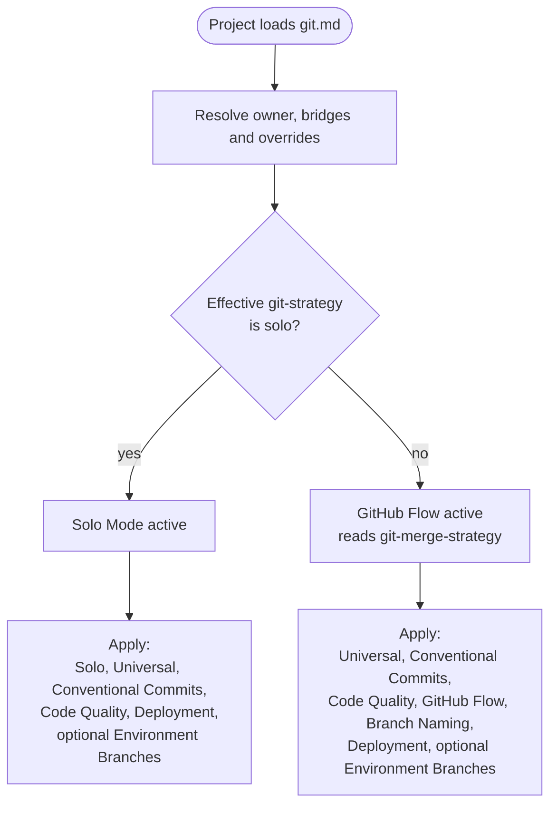

# git.md

The git workflow rules for a project. Defines two strategies (Solo and GitHub Flow), the universal rules that apply in both, the Conventional Commits format used for every commit, code-quality gates before pushing, and optional environment-branch promotion.

## Configuration owner

Use the rule file's Project memory and configuration procedure before Git actions. Configuration may live in CLAUDE.md, AGENTS.md, or an explicit project's memory target, called `{memory_file}` below. Both the standard Project Config section and Compass's fenced configuration block are recognized. Preserve wrappers and active override precedence, and resolve invalid values, conflicting declarations, missing targets, or cycles before branching. Copied rules carry this procedure themselves; no loaded plugin runtime is required. New shared setup uses AGENTS.md as owner and a CLAUDE.md import adapter. Only log offers reviewed migration; other workflows preserve existing owners.

## Host capabilities and operational state

Copied rules retain these boundaries without Helm's runtime. Before acting, verify the shell operates on the selected consumer working tree and that required Git, credentials, local tools, Docker, test environments and provider access are actually available. Folder access alone establishes none of those capabilities.

Unavailable tools, permissions or required checks block the affected action. Report completed and pending work separately, verify command results, and preserve existing work on failure instead of continuing publication/cleanup or resetting/stashing drafts. Tool permission does not replace workflow confirmation or permit automatic client-setting changes.

Operational records under `.helm/`, legacy `.claude/helm/`, and known flat legacy ledger paths are excluded from ordinary discovery, edits and unrelated staging. Only the explicitly invoked owning Helm workflow may access/update its own state or perform validated per-file migration. Loading copied rules or switching agents never triggers migration; see [safety.md](safety.html#operational-helm-state) for the standalone boundary.

## Git Strategy



Read `git-strategy` from the resolved owner's recognized configuration. Set to `solo` for Solo Mode or `github-flow` for GitHub Flow. Absence defaults to GitHub Flow. Exactly one strategy is active at a time. The `git-auto-commit: true` flag is independent of strategy. The `git-merge-strategy` flag applies only under GitHub Flow and sets the PR merge method (`squash`, `rebase`, or `merge`; defaults to `squash`).

After resolving configuration, confirm which mode is active before taking any git action. State it explicitly: "Solo Mode active" or "GitHub Flow active."

Resolve `{base_branch}` to the project's actual `main` or `master` before creating branches, committing, integrating, publishing or promoting. Use project instructions, the default branch and existing refs; stop if ambiguous or unavailable rather than guessing or renaming a branch. Without a repository or HEAD, follow only an explicitly authorized bootstrap plan. Missing instruction files do not bypass strategy in an existing repository. Recheck effective instructions/configuration after branch changes, preserving invocation policy.

### Solo Mode

Activate by declaring `git-strategy: solo` in `{memory_file}`. When active:

- Commit directly to `{base_branch}`. No feature branches required.
- No PR required.
- Skip the GitHub Flow and Branch Naming subsections entirely.
- Environment Branches rules still apply if such branches exist.
- Universal Rules still apply.
- Conventional Commits still apply.
- Code quality checks still run before every push.

Use this mode for solo work where peer review and branch protection have no audience. Switch to GitHub Flow the moment you have collaborators.

Exception: [`/helm:refactor`](../commands/refactor.html)'s `refactor/*` branch and its "Open PR" option in Step 7 are used regardless of `git-strategy`, including under Solo Mode: the sanctioned path for multi-wave, resumable refactor sessions (a session can span multiple runs, and leaving work on a branch between them is the point), not an ad-hoc feature branch. Same reasoning as `/helm:ship`'s exception below, applied to a different command.

### GitHub Flow (default)

Active when `git-strategy: github-flow` is declared, or when `git-strategy` is absent.

**Branch structure**

```
{base_branch} (main or master)
feature/*  (or feat/*)
fix/*
chore/*
refactor/*
docs/*
test/*
perf/*
ci/*
build/*
```

**Rules**

- All branches base from `{base_branch}`.
- `{base_branch}` is always deployable.
- Open a PR before merging to `{base_branch}`.
- Merge using the strategy declared as `git-merge-strategy` (default: `squash`). Before merging, confirm which is active, the same self-check as `git-strategy` above. State it explicitly: "Squash merge", "Rebase merge", or "Merge commit."
  - `squash`: squash all commits into one with a Conventional Commit message
  - `rebase`: replay branch commits onto `{base_branch}` without a merge commit
  - `merge`: create a merge commit preserving full branch topology
- If CI is configured, it must pass before merge.

#### Branch Naming

Only applies under GitHub Flow.

Format: `type/short-description`. Include a ticket number when provided: `type/123-short-description`.

```
feature/user-authentication
feature/123-user-authentication
fix/payment-timeout
fix/456-payment-timeout
chore/bump-dependencies
refactor/extract-payment-service
```

Types mirror Conventional Commits types. Lowercase, hyphens only, no spaces.

## Auto-Commit

Governs every commit made by any command in this plugin, by default; individual commands don't restate this, only follow it, unless an explicit exception applies (see below).

Set with `git-auto-commit: true` in `{memory_file}`'s recognized configuration. Independent of git strategy: works with both Solo and GitHub Flow. Absence defaults to off: ask for confirmation before every commit.

When active:

- After completing a task, commit without asking for confirmation.
- Stage only the files changed for the task. Never use `git add -A` blindly.
- Derive the commit message from the work done; follow Conventional Commits.
- Push still requires confirmation: same rule as Universal Rules → Safety below, restated here since it's the exception auto-commit doesn't override.
- If the task spans multiple logical units, commit each unit separately before moving on.

**Exception:** commits covered by [`safety.md`](safety.html#agent-execution-boundaries)'s Agent Execution Boundaries (e.g. committing generated legal documents via [`/helm:legal`](../commands/legal.html)) always ask for confirmation regardless of this setting. Those are public or otherwise high-stakes content where autonomy level should never skip review.

## Universal Rules

Apply in both strategies.

**Branches**

- Never commit to `main` or `master` outside Solo Mode.
- Never force-push without explicit confirmation.
- Never delete unmerged branches without explicit confirmation.
- Never delete `main`, `master`, or any environment branch.
- Never delete a published tag from a public repository.
- After verified integration and any required publication, leave the feature branch safely and delete locally only with no pending work, its tip inside base ancestry, and a successful `git branch -d`. Squash/rebase may leave the old tip outside ancestry: retain/report the branch instead of using `-D`. A separate destructive cleanup requires explicit review/confirmation. Remote deletion is a push with its own confirmation. Failed or pending work never triggers cleanup.

Exception: release commits made by `/helm:ship` (version bump + tag) may land directly on `{base_branch}` in any mode: the sanctioned release path, not an ad-hoc direct commit.

**Commits**

- Every commit on `{base_branch}` must leave the codebase in a working state.
- One commit per logical unit. If the subject needs "and" to describe it, split it.

**Safety**

- Never push to any branch without confirmation (cross-references `safety.md`).

## Conventional Commits

Every commit follows this format:

```
type(scope): description

[optional body]

[optional footer]
```

**Types**: `feat`, `fix`, `refactor`, `revert`, `test`, `docs`, `chore`, `style`, `perf`, `ci`, `build`.

**Scope**: required. The module, feature, or domain area touched.

```
feat(auth): add OAuth login
fix(payment): resolve stripe timeout
refactor(orders): extract service layer
```

**Multi-scope**: when a change is inseparably about two or more named areas, not just adjacent to them, use a comma-separated scope instead of picking one arbitrarily, e.g. `refactor(log,manifest): merge broken-structure and gap-based recommendation blocks`. Prefer a single scope whenever one area is clearly dominant; keep the list short, or it's really `project`/`core`.

**Scope inference**: for commands that infer scope from a diff or cluster of changed files (e.g. `/helm:refactor`, `/helm:test`), use the primary module, folder, or domain actually touched, never a command's own internal category/priority taxonomy (e.g. "architecture", "high-priority"), which is a report/selection grouping, not a commit scope. Dominant area wins if a change spans multiple, or comma-separated multi-scope if none is dominant; `project` or `core` if truly cross-cutting with no specific areas to name. Keep it lowercase, one word or hyphenated per scope.

**Breaking changes**: append `!` to the type and include a `BREAKING CHANGE:` footer.

```
feat(auth)!: replace session with JWT

BREAKING CHANGE: all existing sessions invalidated
```

The `/helm:ship` command reads these types to calculate the next version: `feat!` or `BREAKING CHANGE` triggers a major bump, `feat` minor, `fix` and `perf` patch (perf is a real improvement to shipped behavior, not a no-op), anything else is ignored for versioning.

## Code Quality

Run before pushing, regardless of strategy:

**Lint and Formatting**

- Detect lint and formatter config in the project.
- Run lint and formatter; fix all errors before pushing.
- Include formatting changes in the last logical commit.
- Skip the lint step if no linter is configured. If a linter is configured, never push with lint errors.

**Tests**

- Detect test framework from project files.
- Run tests for changed files. Run the full suite if shared or core code is touched.
- Skip silently if not configured. Never push with failing tests.

Skipping as unconfigured requires repository evidence. A configured check that cannot run remains blocked, never passed. Before integration, CI must pass for the exact intended commit when required for that integration by GitHub Flow, explicit project policy or provider protection. Solo with no pre-integration remote requirement may integrate after applicable local checks; configured CI alone does not create that requirement. An explicit required remote gate in either mode needs separately confirmed branch publication/checks or a pending review handoff, never local-test substitution or a forced Solo PR. Before promotion, configured/applicable CI must pass for the exact published source SHA. Missing, unavailable, pending, failed, cancelled, incomplete or unknown required results do not satisfy either gate. Recheck changed tips and report capability failures. See [Git and CI behavior](../setup/git-and-ci.html).

## Deployment

Independent of strategy. Applies under both Solo and GitHub Flow.

Determine actual triggers and targets from repository configuration and applicable provider settings. A branch/tag or loaded rule file does not prove a pipeline/deployment exists. Unavailable evidence leaves behavior unknown, not absent or safe.

- A configured push trigger may deploy `{base_branch}` or other explicitly configured branches.
- A configured tag trigger may deploy matching SemVer tags, including ones created through `/helm:ship`.
- Both may exist (e.g. push to staging and tag to production), or neither. Report only verified behavior and retain project-specific deployment approvals.

## Environment Branches (optional)

Independent of strategy. Works alongside Solo and GitHub Flow.

Environment branches are long-lived branches that are not `main`, `master`, or feature branches: e.g. `staging`, `stage`, `uat`, `preprod`, `production`, `prod`, or similar. The presence of any such branch on the remote activates these rules:

- Environment branches are permanent. Never delete.
- Feature work never merges directly to an environment branch; use the approved promotion path.
- All changes flow through `{base_branch}` first (upstream-first rule), then merge into environments only through the approved promotion path.
- Hotfixes follow the same rule: `{base_branch}` first, then promote.
- If CI is configured, it must pass before promoting.

**Promotion model**: governs `/helm:ship`'s release promotion specifically. Set with `environment-promotion` in `{memory_file}`'s recognized configuration (`fan-out` or `chain`; absence defaults to `fan-out`).

Before promoting anything, confirm which model is active, the same self-check as `git-strategy` above. State it explicitly: "Fan-out promotion" or "Chain promotion."

- **Fan-out** (default): `{base_branch}` promotes directly to any combination of environment branches, independently, with no ordering between them. Simple parallel deploy targets.
- **Chain**: environments form an ordered pipeline (e.g. `{base_branch} → staging → production`). Only the first tier (`staging`, `stage`, `uat`, `preprod`) is ever merged into directly from `{base_branch}`. A later tier (`production`, `prod`) is never a direct deploy target; it's only reached by merging the previous tier's branch forward into it, one tier at a time.

`/helm:legal`, `/helm:log`, `/helm:manifest`, `/helm:adopt`, `/helm:env`, and `/helm:test` always use fan-out for promoting their own generated content or fixes (legal documents, `AGENTS.md`, `README.md`, rule files, env/gitignore fixes, tests), regardless of this setting: those are content syncs, not a release pipeline, so there's no tier for the change to pass through.

The [`/helm:ship`](../commands/ship.html) command detects environment branches automatically and offers a multi-select for which to promote alongside the main release (filtered to first-tier branches only under `chain` mode). [`/helm:legal`](../commands/legal.html), [`/helm:log`](../commands/log.html), [`/helm:manifest`](../commands/manifest.html), [`/helm:adopt`](../commands/adopt.html), [`/helm:env`](../commands/env.html), and [`/helm:test`](../commands/test.html) also offer promotion under their own verification/publication gates, so environment branches can receive the resolved base's legal documents, memory-owner updates, `README.md`, installed rules, env/gitignore fixes, or tests.

## See also

- [`safety.md`](safety.html) - the operational risks file that pairs with this one
- [`/helm:ship`](../commands/ship.html) - reads Conventional Commits and promotes to env branches
- [`/helm:legal`](../commands/legal.html) - promotes generated legal documents to env branches the same way
- [`/helm:log`](../commands/log.html) - promotes memory-owner updates to env branches the same way
- [`/helm:manifest`](../commands/manifest.html) - promotes `README.md` updates to env branches the same way
- [`/helm:adopt`](../commands/adopt.html) - promotes installed rule files to env branches the same way
- [`/helm:env`](../commands/env.html) - promotes env/gitignore fixes to env branches the same way
- [`/helm:test`](../commands/test.html) - promotes new tests to env branches the same way
