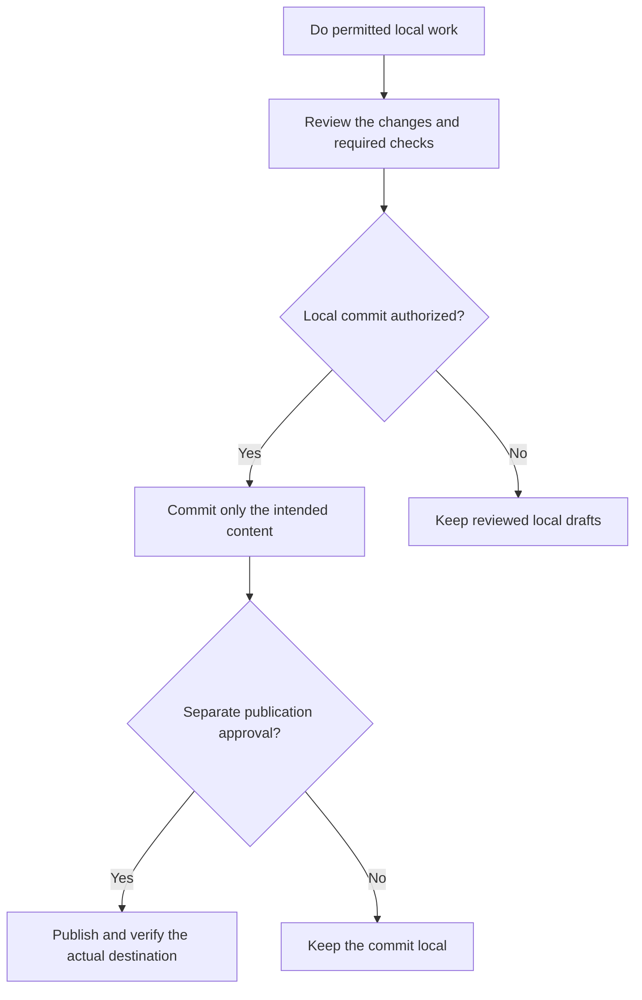

# Git



The Git rule connects project preferences to the actions an agent may take. Its main distinction is between doing local work, saving a commit and publishing that work to a remote destination.

## Flow



## Configuration owner

The rule follows the instructions actually loaded by the client, including imports, nested files and overrides. The normal shared arrangement uses `AGENTS.md`, imported by `CLAUDE.md`, but an existing custom layout is not silently rewritten.

Conflicting settings block the actions that depend on them. A default applies only when a setting is genuinely absent; it does not replace an explicit `false` or another project's declared policy.

| Setting | Absent-setting default | What a choice means |
|---|---|---|
| `ship-method` | `pr` | Use direct publication or a PR/MR review handoff for ordinary shipping. |
| `git-auto-commit` | `false` | Ask before local commits unless automatic local commits are enabled. |
| `git-merge-strategy` | `squash` | Select squash, merge or a permitted rebase for reviewed integrations. |

A rebase preference does not authorize rewriting shared history. Team size and branch naming do not choose these settings. [Log](../../commands/log.html#shared-project-instructions) handles shared-instruction reconciliation.

## Local work

Ordinary edits stay on the current permitted branch. Individual commands add their own preparation requirements; a source preview may be available where a saved scan or a fix is not.

The agent preserves unrelated staged, unstaged and untracked work. It does not reset, stash or commit someone else's changes to satisfy a clean-tree requirement. Source inspection is also separate from permission to execute code or inspect operational records.

For example, a README correction can coexist with an unrelated pending UI change under ordinary editing rules. A command that requires a clean review snapshot must instead report that blocker without absorbing the UI change.

## Auto-commit

When enabled, auto-commit allows completed coherent work to be committed after its required checks. It is not a blanket stage-all instruction. The agent reviews the actual content and index, stages only intended paths or hunks, and verifies the resulting commit.

Explicitly deferred commits remain deferred. Public legal-document commits still require exact content and commit approval. New commits identify the committing agent in a `Co-authored-by` trailer while preserving existing attribution.

Most importantly, auto-commit does not approve publication. A useful local result can remain entirely on your machine.

## Conventional Commits

Helm uses a type, a lowercase module or domain scope and a short description. Project or explicit user policy takes precedence. The external Conventional Commits specification makes scope optional; Helm's default requires it.

```text
fix(payment): prevent duplicate retry charges
docs(setup): explain the required Node version
feat(auth)!: replace the session format
```

The scope describes what changed, not a review severity. A breaking change needs an explanation, whether marked with `!`, a `BREAKING CHANGE:` footer or both. Bodies and trailers retain useful context rather than being discarded for a shorter subject.

## Quality checks

Checks follow the affected code and consumers. Shared changes require the full suite unless you explicitly authorize another plan; project-specific gates still apply. Results must describe the intended snapshot: passed, failed, unavailable and deferred are different outcomes.

A test name, green result from an older commit or successful source build does not prove a new target integration is ready. Failures and unmet protection requirements block dependent publication.

## Publication

[Ship](../../commands/ship.html) reviews the actual destination, outgoing commit, refs and effects before each approved push. Deploy-on-push behavior is part of that decision. PR handoffs, integrations, releases and deployment each need their own evidence.

Results are read back after publication or uncertainty before retries. Branches remain by default; base/environment branches and public published tags are protected. [Normalized history](../../commands/ship.html#publish-normalized-history) and [private archive backups](../../commands/ship.html#publish-an-archive-backup) use their dedicated proof and approval procedures. When original rewrite proof is unavailable, ship can offer an explicitly approved replacement with a verified current-remote backup and fixed leases, while reporting the original rewrite as unverified.

## Explore the source

For implementation details, read [rules/git.md](https://github.com/myowinthein/agent-helm/blob/main/rules/git.md).
