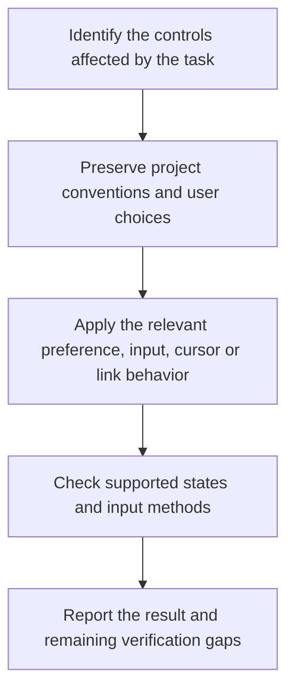

# Interaction



Interaction defines reusable behavior for interface controls and their feedback. Select it explicitly through [adopt](../commands/adopt.html#available-rules); Writing, Design and Interaction are independent options.

Writing guides the explanation, Design guides visual composition, and Interaction guides what controls do and how they communicate their state. Loading this rule adds no controls or redesign by itself.

## Flow

## Controls and feedback

### Feedback and loading

Comparable controls should communicate pending work, success and failure consistently. Quick actions avoid flashing loading indicators; slower work needs clear progress feedback and protection against accidental repeats. A copy confirmation follows an actual clipboard success.

Errors preserve the person's input and leave a way to understand and recover from the failure. Essential feedback remains available without hover, and old messages should not overwrite a newer result. Controls and feedback respect reduced-motion preferences.

### Keyboard focus and autofocus

Keyboard users should be able to identify the focused control throughout their task. Its highlight stays complete at page and scrolling boundaries, with room around text, icons and underlines. Border alignment and spacing follow the project's components without moving nearby content, across supported themes and accessibility settings.

Tab stops should correspond to understandable actions. A shared row highlight should not make separate stops look identical; combining stops still preserves keyboard access to every action.

Moving focus automatically needs a clear purpose because it can scroll the page, open a mobile keyboard or skip context. Tab widgets distinguish keyboard focus from the selected panel; navigation links styled as tabs remain links.

### Preferences and persistence

Reusable choices such as quality or theme can be remembered across visits. Temporary inputs and per-item selections keep their intended lifetime. The rule follows the product's existing settings mechanism and saves deliberate choices, using the documented default when a saved value is missing or invalid.

If a new choice cannot be applied, the control returns to the last working value. If saving is unavailable, the current choice remains usable. Shared preferences can update other open views without clearing unrelated input or silently changing work already underway.

### Theme preferences

The starting appearance follows the system unless a saved choice or project requirement takes priority. Manual Light/Dark choices stay in effect through system changes until the person returns to automatic behavior.

The existing toggle or selector keeps a clear accessible name and selected mode. A visible System option is optional. Design owns how the supported themes look; Interaction owns how the choice behaves and is remembered.

### Input limits

Explain restrictions where they help someone enter or correct an answer. A counter is useful for constrained writing, but a generous technical limit rarely needs one.

For composed text, the usual approach keeps pasted drafts available for correction rather than silently cutting them off. Feedback and counts agree with what the application accepts, including relevant languages and emoji. A working counter alone does not establish that the full validation path works.

### Cursors

The cursor reflects an available action without promising behavior that does not exist. Links, selectable text, disabled controls and working drag handles need different cues, while native controls and established project conventions keep their usual behavior.

A small icon can have a larger activation area. Keyboard and touch use remain available independently of pointer cues.

### Links

Links navigate; buttons perform in-page actions. Destinations should answer the link’s promise, including specific sections where useful.

| Link situation | Default behavior and indication |
|---|---|
| Internal page or section | Current tab; no external-link icon. |
| External text link | Current tab; northeast arrow leaving an open square. |
| Necessary new tab/window | No opening notice; external icon only if the destination is external. |

A new tab or window is reserved for preserving an active task, explicit user choice or a project requirement. Native browser opening choices remain available. Downloads and email, phone or app links keep their native handling, with wording that explains material surprises such as a file format or login requirement.

Labels describe the destination without extra announcements solely for opening a new tab. Internal and external destinations follow the actual site boundary; an absolute URL can still be internal. When Writing is also selected, these choices join its [reference-link workflow](writing.html#reference-links).

### Link appearance

Readers should recognize links before interacting. Prose and reference links normally use visible underlines; clearly grouped navigation, button links, cards and icons can use their established styling.

Links remain readable across supported themes, with visible keyboard focus and feedback that does not move nearby content. Touch users do not need hover to discover them. Visited styling can show reading history, while a current-page marker shows location.

## Scope and verification

Use existing components, storage and validation boundaries. Preserve user input and explicit preferences; a new rule does not authorize unrelated changes. Verify affected states and recovery after completion, cancellation or failure with keyboard, touch and pointing devices. For affected mobile forms, check that fields and actions remain reachable with the on-screen keyboard open. A cursor or hover effect alone does not establish usable interaction.

The hand cursor, external icon and link underline defaults are Helm conventions. Follow explicit project requirements and distinguish these preferences from accessibility requirements. Focus reviews check both keyboard operation and rendered appearance across the affected components and page layouts. Report the pages and states actually checked, identifying representative samples and checks that could not be performed; passing assertions alone do not establish visual correctness.
