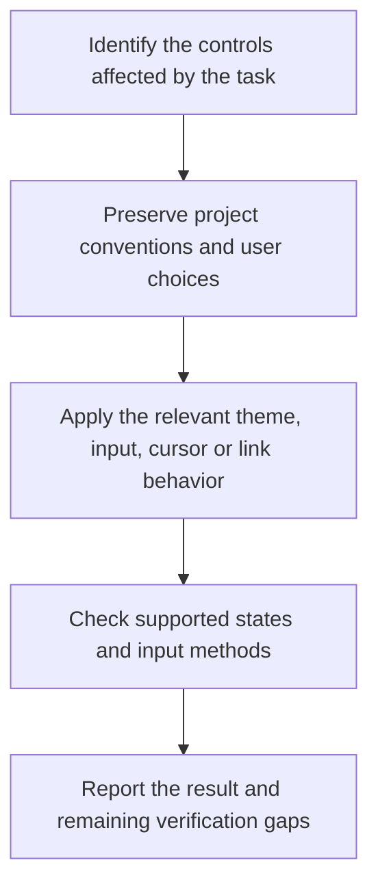

# Interaction



Interaction defines reusable behavior for interface controls and their feedback. Select it explicitly through [adopt](../commands/adopt.html#available-rules); Writing, Design and Interaction are independent options.

Writing guides the explanation, Design guides visual composition, and Interaction guides what controls do and how they communicate their state. Loading this rule adds no controls or redesign by itself.

## Flow

## Controls and feedback

### Theme preferences

When a theme control is part of the task, use the system preference initially unless a valid saved choice or project requirement takes priority. Manual Light/Dark choices win; system changes apply only in automatic mode. Remember choices per project and browser profile across open tabs and later visits. Preserve the existing toggle or selector; a visible System option is optional. Keep the control usable when storage is blocked.

### Input limits

A maximum length does not automatically need a counter. Ordinary fields with generous limits usually need none; fixed-format values need clear instructions. Show a count when people need to plan or shorten their writing, or consider revealing it near a rarely reached limit. Explain important restrictions without relying on placeholders or color alone.

Preserve pasted answers and let people edit excess text where the field permits it. Describe errors without deleting their work, and keep counts consistent with the accepted value, including emoji and other languages. Browser checks help people correct mistakes; receiving code must enforce its own constraints. Local-only apps use their existing save and import boundaries rather than adding a backend.

### Cursors

Match the cursor to what the person can do: a hand for links and enabled custom actions, an I-beam for selectable text, and grab, resize or zoom cursors only for those working operations. Keep native form-control behavior and established design-system conventions. Read-only text can remain selectable; disabled controls should not promise an available action.

Pressing an ordinary button changes its appearance, not its cursor. Processing and dragging can change the cursor when the operation changes. Keep keyboard focus and touch interaction usable, since cursors are only an extra cue. Preserve deliberate project styling without hiding useful operation hints.

### Links

Links navigate; buttons perform in-page actions. Destinations should answer the link’s promise, including specific sections where useful.

| Link situation | Default behavior and indication |
|---|---|
| Internal page or section | Current tab; no external-link icon. |
| External text link | Current tab; northeast arrow leaving an open square. |
| Necessary new tab/window | No opening notice; external icon only if the destination is external. |

New contexts are limited to preserving an active task, explicit user choice or project requirements. Keep native browser opening choices available. Downloads and email, phone or app links use native handling and clear outcome wording. Identify material surprises such as a login requirement or file format.

Do not add visible or hidden notices solely to announce a new tab/window, including label suffixes, tooltips or screen-reader-only equivalents. Keep labels and accessible names focused on the destination.

Classify destinations by the actual site/service boundary and explicit aliases; absolute URLs can be internal. Follow established design-system conventions and renderer limits. When Writing is also selected, apply these choices within its [reference-link workflow](writing.html#reference-links).

### Link appearance

Use clearly visible underlines for prose, reference and table-text links so readers can spot them before interacting. Hover and keyboard focus can strengthen them; color and thickness follow the project's style. Clearly grouped navigation, button links, cards and icons can use their established component styling instead.

Links need readable contrast in light and dark themes, visible keyboard focus and useful feedback without layout shifts. Muted styling should not make links look disabled. Touch users must be able to recognize links without hovering. Use visited styling where reading history helps, keeping it distinct from the current-page marker. Preserve the project's palette and purposeful motion.

## Scope and verification

Use existing components, storage and validation boundaries. Preserve user input and explicit preferences; a new rule does not authorize unrelated changes. Verify affected states and recovery after completion, cancellation or failure with keyboard, touch and pointing devices. A cursor or hover effect alone does not establish usable interaction.

The hand cursor, external icon and link underline defaults are Helm conventions. Follow explicit project requirements and distinguish these preferences from accessibility requirements. Report checks that could not be performed.
