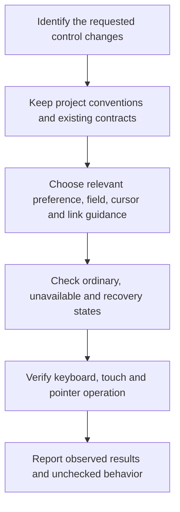

# Interaction



Interaction covers the behavior and feedback people expect from controls. It keeps explicit preferences and input intact while making links, pointer cues and error states predictable. It can be adopted independently of Writing and Design.

## Flow

## Controls and feedback

### Feedback and loading

People should be able to tell whether work is pending and understand its relevant outcome. Errors need a clear connection to the affected task and a useful way forward. Comparable operations should be consistent about when feedback appears, changes and clears, while a page load and a button action can communicate progress differently. Visual treatments follow the project's components and design guidance.

Across buttons, links and other controls, a near-instant action should not briefly flash a loading label, spinner or busy cursor. Slower work still needs clear pending feedback. Delaying that visual must not delay the operation, its accessibility state or protection against duplicate activation. The timing suits the task rather than one universal delay. Keep unrelated controls usable and clear stale loading feedback when work ends; labels, icons and placement follow the project.

Respect reduced-motion preferences across affected controls, feedback and transitions. Purposeful animation can remain where compatible; the same safeguard applies to pointer effects and link transitions.

A timed error needs a lasting way to understand and recover from the failure. For example, search can show a short explanation while a labeled retry control remains available. Four seconds is the default for this recoverable feedback, subject to project and accessibility requirements. Essential errors without another way to understand and recover remain available. Keep the query intact and retry failed setup deliberately, rather than downloading the same unavailable search data on every keystroke. A new query can still start a new search; feedback from an earlier attempt must not replace its result.

For copy controls, “Copied” confirms an actual clipboard result and appears without requiring hover. Its default duration is two seconds from success, with explicit project or accessibility requirements taking priority. If you copy another block successfully, its confirmation replaces the earlier message and copied icon, matching the latest clipboard content. A pending or failed attempt has not replaced that content, so it leaves the earlier confirmation alone.

Copy errors do not accumulate: a new attempt clears earlier error messages and their timers. A concise sentence explains retry or manual copying. When the text remains available to copy manually, the shared recoverable-error timing applies; otherwise the explanation and recovery remain available.

### Keyboard focus and autofocus

Pressing Tab or Shift+Tab should leave the person able to identify the focused control. Its indicator stays visible while focus remains there, as [W3C Focus Visible](https://www.w3.org/WAI/WCAG22/Understanding/focus-visible.html) explains. The two- and four-second feedback timers do not apply. Reuse the project's focus treatment across comparable controls, with appropriate contrast against the surrounding colors; no universal blue rectangle, shape or thickness is prescribed.

A custom indicator needs to remain clear in supported themes and forced-colors mode. Shadows can disappear in forced colors, so a shadow-only design needs a visible alternative. Focus styling should not move neighboring content. W3C's more detailed [Focus Appearance criterion](https://www.w3.org/WAI/WCAG22/Understanding/focus-appearance.html) is AAA, distinct from the AA baseline; preserving a usable native indicator can also be appropriate.

Using `:focus-visible` lets the browser identify when focus needs visual emphasis without forcing the same outline after every mouse click. Keep a visible fallback where needed and preserve native text-input focus, which may still show after a click. Never blur a control merely to hide its outline. Author-created sticky headers, banners and overlays must not entirely hide the focused component under [WCAG's minimum conditions](https://www.w3.org/WAI/WCAG22/Understanding/focus-not-obscured-minimum.html).

Autofocus is a separate decision: it moves focus automatically. It can scroll the page, open a touch keyboard or bypass context, as [MDN explains](https://developer.mozilla.org/en-US/docs/Web/HTML/Reference/Global_attributes/autofocus). Use it for a clear task purpose rather than appearance, and preserve the person's focus during routine updates.

For actual tab widgets, focus identifies the current keyboard position while selection determines the visible panel. The [WAI tabs pattern](https://www.w3.org/WAI/ARIA/apg/patterns/tabs/) recommends automatic activation on focus only when panels appear without noticeable delay; slower panels use manual activation with Enter or Space. This pattern does not turn ordinary page-navigation links into widgets merely because they look like tabs.

### Preferences and persistence

A reusable preference and a temporary selection have different lifetimes. Someone may expect quality or display density to survive a later visit, while a resolution chosen for one item can remain specific to that item. Preserve the product's intended scope rather than saving every control automatically.

| Intended lifetime or use | Suitable existing mechanism |
|---|---|
| Current page only | In-memory state. |
| Reloads within one tab session | `sessionStorage`. |
| Small non-sensitive choice across visits | `localStorage`. |
| Setting needed by the server or account | Established cookie/account mechanism, as appropriate. |

[Local storage](https://developer.mozilla.org/en-US/docs/Web/API/Window/localStorage) belongs to an origin within a browser profile. It does not automatically follow someone to another browser or device, and clearing site data removes it. Give each project and setting its own key where projects share an origin. Reuse existing account synchronization when required; remembering a browser preference does not call for building a new backend.

Save intentional changes rather than turning a calculated default into a saved choice on page load. Validate restored values and use the documented default for missing, cleared or invalid values without automatically rewriting storage. Keep the current choice usable in memory if reading or writing fails. Present restored choices consistently without misleading initial selections or broken server/client rendering.

Saving a preference and applying it are separate outcomes. If switching from Dark to Light fails, leave Dark applied and restore Dark in the control. Save the new choice only after it works. The brief error explains the failed attempt, while the control continues to show the working value and lets the person try again directly.

Shared choices can update other open views without resetting unrelated inputs or writing the same value back repeatedly. For example, an ongoing download can retain the quality it started with while the new preference applies to the next download. A product with intentional live controls can define another behavior. Per-item or per-view choices remain separate.

### Theme preferences

Automatic behavior can work behind a simple Light/Dark toggle. Keep the project's existing control and settings mechanism; a System option is useful when already supported, but the rule does not require adding one.

The important distinction is between the visitor's choice and the appearance currently shown:

| Situation | Expected behavior |
|---|---|
| No valid saved choice | Follow the browser-reported system preference, subject to an explicit project default. Use the project default or light if the browser cannot report a preference. |
| Visitor chooses Light or Dark | Apply and remember that choice, even when it matches the current system theme. |
| System theme changes | Update only while following the system; preserve manual overrides. |
| Another tab changes this project's preference | Reflect the new choice in its other open tabs and windows. |
| System is selected, when available, or the override is cleared | Resume automatic behavior. |
| Storage is blocked | Keep switching available for the current page; a later visit may return to the default. |

For example, an initial dark system theme should not create a saved Dark override. If the visitor then chooses Light, the site stays light through later system changes until that override is changed or cleared.

Themes use the shared persistence guidance above. Their additional system-following behavior does not create a System mode for quality or other unrelated settings; each keeps its own product default.

Set the initial theme before the page appears so the wrong scheme does not flash first, and keep browser-drawn controls aligned with it. Verify the automatic and manual paths, updates in another tab and unavailable storage. These defaults guide theme work; they do not introduce a new control, account service or redesign into unrelated tasks.

### Input limits

Start with the reason for the limit. A fixed-format code and a short biography need different guidance, even though both accept text. A generous storage ceiling rarely needs a permanent counter. If normal answers repeatedly hit that ceiling, the constraint may need reviewing rather than more interface decoration.

| Field or task | Useful feedback |
|---|---|
| Ordinary name, email or address with a generous technical limit | No counter; explain unusual restrictions when they matter. |
| Six-digit verification code | A clear six-digit instruction; the format already communicates the length. |
| Title, short biography or other constrained writing | Maximum length and a live count that helps with composition. |
| Longer answer that rarely reaches its limit | Consider showing the count near the limit; choose the threshold for that task. |

These defaults draw on [GOV.UK](https://design-system.service.gov.uk/components/character-count/) and [USWDS](https://designsystem.digital.gov/components/character-count/). Neither calls for a counter simply because a field has a maximum. Input width can suggest the expected answer size, while borders or progress indicators can reinforce the limit. Important restrictions and detected errors still need understandable text; a red border or disappearing placeholder is insufficient.

**Keep the person's answer intact.** For composed text, it is usually more helpful to accept a full pasted draft, explain that it exceeds the writing limit and let the person shorten it before submission. For example, “12 characters over the limit” tells them how much editing is needed. Do not silently cut off the end of an answer or discard it after an error. Hard stops can suit specific field requirements, but need a deliberate choice and clear feedback. A larger resource-safety bound can still protect the application while ordinary editing allows temporary excess.

Associate each hint, counter and error with its field. Visible counts can update during typing, while screen-reader announcements should wait for a pause or another meaningful transition. Avoid interrupting text composition in languages that assemble characters through several keystrokes. Preserve paste, keyboard operation and the ability to correct the answer.

The visible counter must agree with what the application accepts. HTML `maxlength` measures UTF-16 units, which can differ from the characters a person sees. Emoji, combining characters and newline handling can expose that difference. Prefer counting user-perceived characters for writing tasks when the receiving data contract supports it; otherwise make the actual constraint understandable. Reuse agreed normalization and validation rather than stripping meaningful text to make it fit.

**Feedback and enforcement have different jobs.** Browser validation helps users correct mistakes, but requests can bypass it. A backend must independently validate accepted input. A local-only app or extension instead checks its existing save, import and outgoing-data boundaries; the rule does not require creating a server. Programmatic and imported values also need validation because native input restrictions do not cover every path. [OWASP's guidance](https://cheatsheetseries.owasp.org/cheatsheets/Input_Validation_Cheat_Sheet.html) explains why client checks cannot protect a receiving service on their own.

When a task only changes the interface, preserve the existing accepted-data contract and report any receiving-validation gap outside that scope. Check values around the limit, pasted and imported text, relevant languages, accessible feedback and recovery after a rejected answer. A working counter alone does not prove the whole validation path works.

### Cursors

A cursor describes an available operation at the pointer's location. An enabled Save button can use a hand; pressing it needs visible pressed feedback rather than a different cursor. If saving starts a pending operation, its feedback should reflect that state and return to normal after success or failure.

Pointer activation also depends on the actual clickable area and its separation from neighboring controls. [WCAG 2.2's target-size minimum](https://www.w3.org/WAI/WCAG22/Understanding/target-size-minimum.html) is 24 by 24 CSS pixels, with spacing and other exceptions, including inline text links. A small icon can have a larger activation area; visual size alone does not establish compliance. Preserve stronger project requirements.

| Situation | Expected cue |
|---|---|
| Ordinary content | Browser defaults, including text selection. |
| Link or enabled custom action | Hand across its actual clickable area. |
| Editable or selectable read-only text | Native text-selection behavior or an I-beam. |
| Native select, checkbox, radio or slider | Existing browser/component behavior. |
| Disabled custom action | Prohibited cursor or the established design system's arrow; no enabled-action hover cue. |
| Working drag handle | Open hand, becoming a grabbing hand during the drag. |
| Working resize or zoom control | Cursor matching the available direction or zoom action. |
| Longer pending work | Progress while interaction remains possible; wait only for a blocked interaction. |

The hand on custom actions is Helm's default convention. It is not a universal requirement: [Tailwind follows native button arrows](https://tailwindcss.com/docs/upgrade-guide#buttons-use-the-default-cursor), while [GOV.UK uses a hand for its menu button](https://design-system.service.gov.uk/components/header/history/). Preserve a project's established design system rather than treating a different valid convention as a defect.

Scope cues carefully. A card with one linked title should not show a hand over unrelated text. A read-only email field may still allow selecting and copying; it should not look prohibited. A Copy button uses the normal action cursor, while a drag that copies an item can use the transfer cursor. Use help, zoom and resize cues only where those operations work, and restore normal cues when processing or dragging ends.

Cursors do not provide behavior. Native disabled controls or correctly implemented unavailable actions must prevent activation; a cursor, `aria-disabled` or disabled pointer events alone cannot cover every input method. Ordinary actions should use native click activation so users can move away before releasing to cancel. Drag operations need keyboard access and an alternative using clicks or taps without dragging unless an exception applies. These expectations follow W3C's [pointer cancellation](https://www.w3.org/WAI/WCAG22/Understanding/pointer-cancellation.html) and [dragging guidance](https://www.w3.org/WAI/WCAG22/Understanding/dragging-movements.html).

Prefer system cursors to decorative replacements or trails. A deliberate project-specific design can remain when it preserves selection, native controls and useful operation cues. Cursor shapes vary by platform, and touch users may see none. Keep controls recognizable, focus visible and touch actions available independently; verify hover, press, unavailable states and recovery with the tools available.

### Links

Links navigate to destinations; buttons perform actions. A phrase about a particular procedure should reach the relevant section rather than making readers search from a homepage.

| Situation | Default treatment |
|---|---|
| Internal page or section | Current tab, without an external-link icon. |
| External text navigation | Current tab, with the northeast arrow leaving an open square. |
| Required new tab or window | No opening notice; external icon only for an external destination. |
| Download or email/phone/app action | Native handling and wording that explains the outcome. |

A shared organization or parent domain does not automatically make two services internal. Use the actual site boundary and configured aliases. Preserve native middle-click, modified-click and browser menu choices.

A new context can preserve an unfinished task or meet an explicit product requirement. Merely being external is insufficient. Do not add visible or hidden announcements for opening behavior: no label suffixes, tooltips, accessible-only text, live announcements, dialogs or shared group notices. Keep labels focused on the destination; the icon identifies an external destination independently of tab behavior. When Writing is also selected, use its [reference workflow](../writing.html#reference-links) to decide which phrases need links before applying these interface choices.

### Link appearance

Readers should recognize a link before moving a pointer over it. Underlining is the default for prose, reference lists and table text. Keep the underline clearly visible against its background at rest, choosing color and thickness suited to the project. Hover and keyboard focus can strengthen it or another established cue. A standalone text link follows that default unless it already belongs to a clearly recognizable component.

Other contexts communicate interaction through their structure:

| Component | At rest | Hover feedback |
|---|---|---|
| Header, sidebar, breadcrumbs or footer navigation | Clear grouping and placement can replace an underline. | Consistent underline, background or color emphasis. |
| Button-styled link | Keep its button appearance. | Use the existing button treatment. |
| Linked card | Make the linked title or navigation affordance recognizable. | Emphasize the title, border or background, preserving suitable motion. |
| Icon or logo link | Use recognizable placement and a meaningful accessible name. | Feedback suited to that component; no underline needed. |

For example, a sentence linking to a Git procedure should not require hover to reveal that part of the text is clickable. A clearly grouped sidebar menu can communicate navigation without underlining every entry. Neither case calls for replacing the project's colors or removing its personality.

**Readability applies to every state.** Ordinary link text needs at least 4.5:1 contrast against its actual background in rest, hover and any visited styling; qualifying large text needs 3:1. Muted colors can support secondary navigation, provided the links remain readable and do not resemble disabled controls. An underlined link can use a readable body color; blue is not mandatory.

Distinguishing a link from nearby prose is a separate question. Helm defaults to underlines, but WCAG does not require them everywhere. Where an explicit project convention omits them, another persistent distinction is needed. W3C's [G183 technique](https://www.w3.org/WAI/WCAG22/Techniques/general/G183) uses at least 3:1 contrast against surrounding text. That comparison does not replace the text-to-background check. Reserve ordinary underlines for links so readers do not mistake non-link emphasis for navigation.

**Keyboard and touch users need the same clarity.** Keep a visible keyboard focus indicator, using the project's existing treatment and meaningful hover emphasis where appropriate. Essential labels and external indicators remain available without hover. Avoid font-size or font-weight changes that move neighboring content.

Visited styling is useful when people need to know which references they have read. It is optional when history adds little, such as a primary menu or button link. A current-page marker answers “where am I?” rather than “have I visited this?”; keep those meanings distinct.

## Scope and verification

The rule uses the project's existing components, palette, preference storage and accepted-data contracts. It does not introduce a backend, a new theme selector or a redesign merely to enforce its defaults. Writing owns editorial references and prose; Design owns visual composition and responsive layout. When selected together, their relevant guidance applies within the same task.

Verification follows the affected area: preference changes need checks of restored/default values, storage failures, view synchronization and unaffected active work. Theme changes also need initial-appearance and system-change checks; input changes need boundary, counting and preserved-answer checks. Focus changes need Tab and Shift+Tab checks, persistent visible indication, supported themes/forced colors, stable layout and deliberate focus placement. Cursor and link changes need the relevant hit areas, states, destinations and feedback. Verify recovery after completion, cancellation or failure, with keyboard and touch access even when the visible change concerns a cursor.

For affected mobile forms, also check whether fields and actions remain reachable when the on-screen keyboard is open. It can change the visible viewport without changing the layout viewport, as [MDN explains](https://developer.mozilla.org/en-US/docs/Web/API/VisualViewport). The rule asks for usable results, not a particular viewport API or script.

Source inspection, screenshots and observed interaction provide different evidence. Report important gaps and unavailable checks in the normal task handoff without claiming complete accessibility or creating a separate report merely to follow this rule.

## Explore the source

For agent instructions, read [rules/interaction.md](https://github.com/myowinthein/agent-helm/blob/main/rules/interaction.md).
