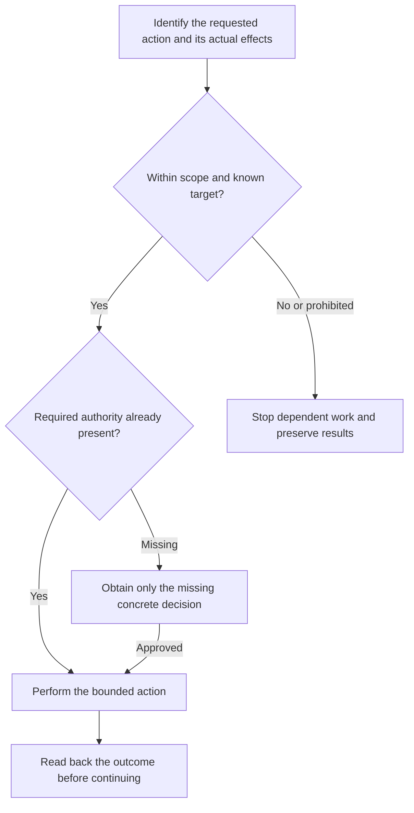

# Safety



Safety helps an agent continue useful work while respecting the authority and evidence each action needs. It focuses on actual effects: what will change, whose resources are involved and what can be preserved if something fails.

## Flow

## Agent execution boundaries

The same command can have different effects in different projects. A test may be a local calculation, or a wrapper that imports data and contacts a shared service. The agent checks the relevant script, hooks and target before execution rather than trusting its name.

| Decision | Example and response |
|---|---|
| Proceed | Make a requested source correction or run an established safe check within scope. |
| Obtain missing authorization | Review the concrete destination and effects before a push, data import, deployment or destructive cleanup. |
| Stop dependent work | Respect a prohibition, unknown target or unmet required gate; preserve progress and continue independent permitted work. |

A sufficiently specific direct request can already authorize an action. The rule does not require asking the same question again while content, target and effects still match. Tool access, silence and an unchecked default provide no substitute for human intent.

## Protect work and verify effects

Preserve unrelated edits, staged hunks and local inputs. Git can recover committed source, but not every discarded draft, overwritten database or remote message. Requested targeted editing is different from wholesale discard.

After a failure or timeout, establish the actual state before continuing. For example, a network timeout after a publication request does not prove the destination was unchanged. Readback can prevent a duplicate or destructive retry.

Credentials and private records stay out of chat, logs, commits and unapproved uploads. Delegation gives a worker the same or narrower authority; another agent cannot approve a consequential action on your behalf.

## Maintaining command outputs

A file created by a command can still be ordinary maintainable source. What matters is its actual role:

| Role | What maintenance preserves |
|---|---|
| Editable source, guides or instructions | Useful custom content, behavior, ownership and unaffected work. |
| Legal commitments or test protection | Required content approval and the guarantees people rely on. |
| Actual generated output | Its authoritative input and the approved generator. |
| Assessment or recovery evidence | Its owning workflow and historical provenance. |

Editing an agent-written guide does not require rerunning the command that first created it. Conversely, hand-editing a generated file or marking a saved finding fixed does not establish a verified result.

## Host capabilities

The agent verifies only the capabilities needed for the action: the actual workspace, account, runtime and target. Folder access is not proof of Git permissions or a safe database. Missing access blocks the dependent action while drafts and completed results remain intact.

These Markdown rules guide decisions. They do not provide an OS sandbox, enforce teammate coordination or guarantee that unsafe behavior is impossible.

## When to run a safety scan

A [log Full scan](../../commands/log.html#what-the-review-covers) includes static operational review. Changes to deployment, data, credentials or destructive scripts need focused reassessment. A routine prose edit does not trigger a full-project scan.

Findings explain the risk, inspected evidence, uncertainty and proposed instruction. Project-specific hazards belong in the shared instruction owner's Hard Safety Rules after review, rather than being added to a reusable rule for every consumer.

## Operational Helm state

Saved ledgers, archive bundles and private recovery evidence are not ordinary source-cleanup inputs. Only the explicitly invoked owning workflow, or a narrowly defined publication procedure, accesses its permitted state.

Source maintenance leaves those records opaque. Unsupported historical state is not automatically migrated or deleted. A source fix, a completed assessment and a verified closure are separate results, with their own evidence.

## Explore the source

For implementation details, read [rules/safety.md](https://github.com/myowinthein/agent-helm/blob/main/rules/safety.md).
