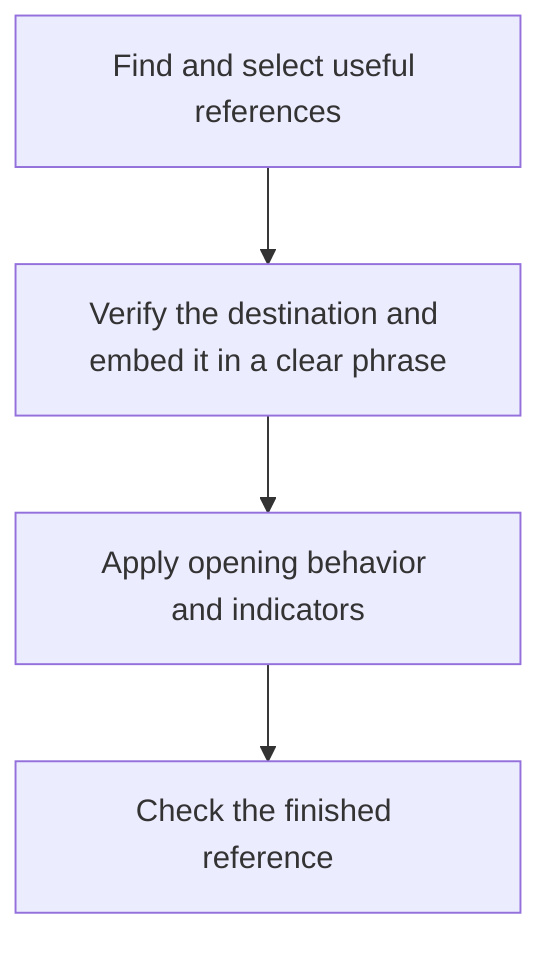

# Writing



Write clear, useful prose for people: replies, guides, UI text, comments and commit or release descriptions. Helm commands load this rule; [adopt](../commands/adopt.html) can install it independently.

## What it asks the agent to do

Lead with the answer, purpose or action. Give readers what they need to understand, decide or act, using familiar words and consistent terms. Remove filler and hype while preserving facts, uncertainty and warnings.

Depth follows the audience and task. A guide need not mirror its source’s detail. Maintenance should improve the affected passage at its intended depth, keeping necessary steps and decision context visible.

## Choose useful formatting

Use paragraphs for connected explanations, lists for choices or steps, and tables for comparisons. Code blocks preserve exact commands and configuration. Add diagrams or examples when they explain the subject more clearly.

Follow the destination’s supported formatting and existing conventions. Formatting should help readers find information without adding padding or hiding essential warnings. Avoid em dashes in new prose while preserving exact syntax and meaningful punctuation.

## Reference links

Treat references as one workflow, from finding useful phrases to checking the finished link:

Link when it helps readers act, understand context or verify a claim. Default to one useful contextual link per destination per page; distant sections, independent tasks and required citations can justify repetition. Every mention need not become a link.

Specific topics point to the relevant section; broad introductions point to the page. Prefer authoritative external sources. Check meaning and actual section anchors, then wrap an existing clear phrase. Change wording only as much as needed to correct a vague or mismatched label.

Use the project's verified canonical URLs, preferring HTTPS where supported. Preserve working hostnames; non-www is a default for new projects only when hosting and HTTPS support it. Display origins like `https://example.com` without a trailing slash, while page paths follow the site's routing; a serialized root `/` remains valid. Preserve queries, fragments and external sites' canonical addresses.

**Current tab is the default for internal and external links.** New tabs are limited to preserving an active task, explicit user choice or a project requirement. Do not add visible or hidden opening announcements, including label suffixes, tooltips or screen-reader-only notices. Native browser choices remain available.

A northeast arrow leaving an open square marks external text links, independently of tab behavior. Internal new-tab links get no external arrow. Downloads and email, phone or app links use native handling and clear outcome wording. Respect established project conventions and renderer limits.

Check the resulting sentence, destination and fragment. Preserve existing anchors when headings change and report verification gaps. [Design](design.html#responsive-interfaces-and-links) adds interface guidance when selected; it requires no second reference pass.

## Examples

| Before | After |
|---|---|
| Utilise this command to commence installation. | Use this command to start installation. |
| It is important to note that this action may permanently delete data. | This action may permanently delete data. |
| FooCLI is a seamless solution that empowers developers to manage configuration. | FooCLI helps you manage configuration. |

## Scope and safeguards

Follow explicit requirements, required formats, voice and locale. Edit only the requested scope; protect code, quotations, legal obligations and material limitations. Brevity is neither a word quota nor an authorship test. Loading the rule starts no scan or bulk rewrite.
