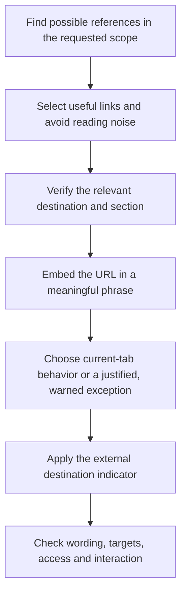

# Writing



{{ page.guide_source | guide_intro }}

## Reference-link workflow

The full rule follows. It is the same source that agents load or adopt into a project.

{{ page.guide_source | guide_body }}
