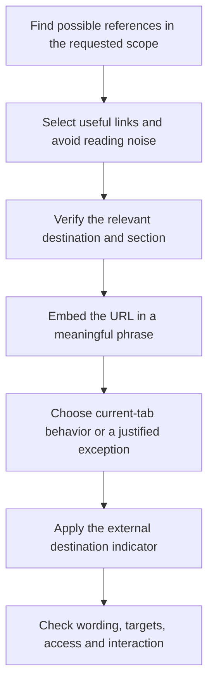

# Writing



Writing guides prose that people can understand and use. It applies to replies, documentation, interface copy and useful comments, with depth chosen for the reader rather than copied from the amount of available source material.

## What it asks the agent to do

Start with the answer, purpose or action. Add the explanation a reader needs to understand, decide or proceed, using concrete facts and familiar words. Keep necessary technical terms consistent and explain them when the audience needs help.

Clear writing can be detailed. An Overview establishes the journey; a Details guide explains the decisions and examples along that journey. Neither needs to reproduce every implementation instruction. Necessary qualifications, uncertainty and warnings remain visible even when the surrounding prose is shortened.

When editing, preserve the requested scope and surrounding voice. A loaded writing preference is not permission to restyle a whole project, change quotations or rewrite legal commitments. Unsupported claims, invented measurements and generic praise should be removed rather than made more polished.

## Choose useful formatting

Use connected paragraphs for explanation, lists for parallel choices or ordered steps, and tables when readers need to compare shared attributes. Code blocks keep exact syntax separate from prose. A diagram should explain relationships or choices that would otherwise be harder to follow.

Formatting is a means of understanding, not a variety quota. A short answer can be one paragraph; a complex procedure can need several sections and examples. Keep essential warnings beside the relevant action instead of hiding them in optional material.

New prose normally avoids em dashes, decorative punctuation and repeated rhetorical templates. Exact identifiers, meaningful Unicode, quotations and required formats are preserved.

## Reference links

### Find useful references without linking everything

Read the passage for references that help someone act, understand context or verify a claim. A named internal procedure or an authoritative external explanation may deserve a link; an incidental product name does not automatically need one.

Default to one useful contextual occurrence per destination on a page. Distant sections, independent entry points and required citations can justify repetition. Do not add adjacent links that merely send the reader to the same explanation twice.

### Match the destination, then preserve the phrase

A specific topic should lead to the relevant section when it answers the question without skipping prerequisites. A broad introduction should lead to the page. Read the destination and verify the actual section anchor; a successful HTTP response alone does not establish relevance.

Wrap an existing clear phrase. Make only the smallest wording correction needed for a vague or misleading label. For example, a sentence about a release decision should link to [the release section](../../commands/ship.html#optional-versioned-release), while a general introduction to publishing can link to the whole ship guide.

Use verified canonical domains and actual routes. HTTPS is preferred where supported. Preserve working hostnames; non-www is only a default for a new project when hosting supports it. Display an origin as `https://example.com`, but keep path slashes, queries and fragments according to the destination's router. External websites retain their own canonical form.

### Choose opening behavior and indicators

Internal pages, same-page sections and external references open in the current tab by default. A new tab is justified for preserving an active task, an explicit user choice or a project requirement. Do not add an announcement solely for that behavior: no visible label suffix, tooltip, hidden text, accessible-name suffix, live announcement, dialog or shared group notice. Keep destination labels and accessible names useful. Native modified clicks and browser menus remain available.

The external-link indicator describes the destination independently of tab behavior: one northeast arrow leaving an open square follows external text links. An internal link that opens a new tab does not acquire an external icon. An arrow does not replace a meaningful label.

Downloads and email, phone or app links use native handling and clear outcome wording. Renderer limits matter: ordinary Markdown cannot promise behavior controlled by GitHub or the browser.

### Verify the finished reference

Read the linked phrase back in its sentence, check the destination and fragment, and preserve established anchors when headings change.

Where styling is controllable, prose and reference links default to clearly visible underlines at rest. Clearly grouped navigation, button links, cards and icons can use their established component treatment. Keep hover emphasis, visible keyboard focus and any visited styling readable. Essential labels and indicators must work without hover, including on touch devices. A renderer such as GitHub may control those styles itself.

Interface changes also need the relevant visual-state, keyboard, focus and opening checks. When Design is selected, its [link appearance criteria](../design/detailed.html#link-appearance) apply within this verification step. A second linking pass is unnecessary. Report unavailable verification rather than describing inspection as a tested interaction.

## Examples

| Less useful | Clearer |
|---|---|
| Utilise this command to commence installation. | Use this command to start installation. |
| This seamless solution empowers developers. | Explain the actual task the tool helps complete. |
| A long guide should include every source detail. | Explain the reader's journey and link implementation detail where useful. |

## Scope and safeguards

Explicit requirements, locale, required formats and project voice take precedence over stylistic defaults. Code, quotations, attribution, legal wording and material limitations are not disposable filler.

The rule is a writing preference, not an authorship detector or a reason to add deliberate mistakes. It starts no scan or bulk rewrite by itself. Useful depth and comfortable reading determine the result; word or line quotas do not establish quality.

## Explore the source

For implementation details, read [rules/writing.md](https://github.com/myowinthein/agent-helm/blob/main/rules/writing.md).
